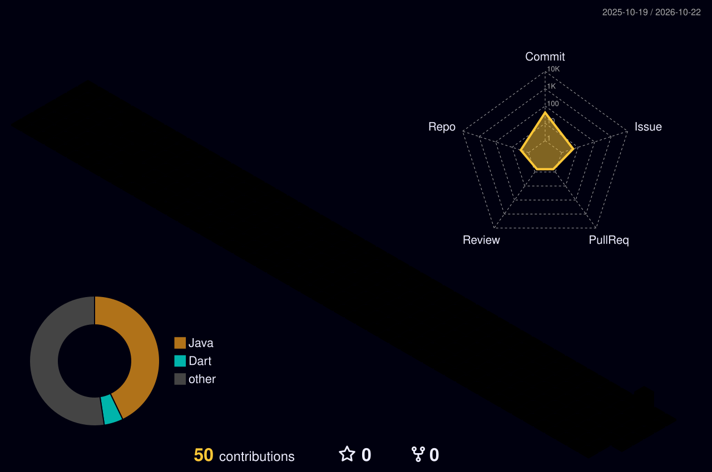

 

<table align="center">
<tr>
<td align="center" width="25%"><h2>93,5 %</h2>de précision en prédiction de pathologie (MedAIChain)</td>
<td align="center" width="25%"><h2>100 %</h2>hors ligne : application de randonnée en zone sans réseau</td>
<td align="center" width="25%"><h2>20 / jour</h2>commandes en ligne générées pour un restaurant client</td>
<td align="center" width="25%"><h2>OCPP 1.6J</h2>bornes de recharge réelles pilotées par Volteo</td>
</tr>
</table>

## 👩‍💻 À propos

Élève ingénieure en informatique à **ESPRIT** (2022 – 2027), spécialité **Systèmes d'Information Mobile**. Je livre des produits complets en autonomie, **du cahier des charges au déploiement en production** : applications mobiles offline-first, pipelines de données temps réel, intégrations d'IA et de blockchain.

> 🎯 **Disponible pour un PFE de 6 mois à partir de février 2027.**

## 💼 Expérience

<b>🤖 Smartovate</b> · Junior AI Engineer (freelance) · <i>depuis 09/2026 · Londres, à distance</i>

 

**Pipeline temps réel de détection de fraude bancaire**
- Architecture d'un pipeline de streaming (ingestion → validation → scoring → restitution) sur **Kafka / Redpanda** et Python.
- Modèle **XGBoost** de scoring de fraude avec extraction de features comportementales (profil client, écart au panier moyen, fréquence).
- Contrôles qualité et **idempotence** : un rejeu du pipeline ne crée aucun doublon sur des données bancaires sensibles.
- Observabilité : logs, métriques et tableau de bord de suivi des performances du modèle.

`Python` `Kafka` `Redpanda` `XGBoost` `Streaming ML` `PostgreSQL` `AWS`

<b>🥾 RZ Prod</b> · Développeuse full stack (freelance) · <i>05/2026 – 07/2026 · Tunisie</i>

 

**Plateforme de randonnée et d'écotourisme, en partenariat avec le PNUD, le GEF/SGP et la SMSA**
- Architecture **offline-first** pour une zone de montagne sans réseau : cartes et sentiers en cache SQLite (GeoJSON), navigation GPS, alertes de sortie de sentier et **bouton SOS 100 % hors ligne**.
- Conception d'une seconde application, **EcoTracer**, qui enregistre les sentiers par GPS en temps réel, validée sur le terrain en 2 campagnes de tests en montagne.
- Chatbot IA **EcoBot**, bilingue français / arabe, avec quiz sur la faune, la flore et l'écotourisme.
- Livré en équipe de 2 en 3 mois : application Flutter, EcoTracer, back-office Flutter Web, API NestJS + PostgreSQL / PostGIS.

`Flutter` `NestJS` `PostgreSQL` `PostGIS` `SQLite` `GPS` `IA`

<b>🍕 Speranza Pizza</b> · Développeuse (freelance) · <i>09/2025 – 10/2025 · client en France, à distance</i>

 

- Site de commande en ligne mis en production (Firebase, Vercel, Hostinger, paiements **Stripe**), jusqu'à **20 commandes par jour**.
- Application mobile d'administration pour suivre les commandes en temps réel.

`Firebase` `Stripe` `Vercel` `Mobile`

<b>💻 Linedata</b> · Stagiaire développeuse .NET / Blazor · <i>07/2025 – 08/2025 · Tunis</i>

 

- Deux applications web **Blazor** synchronisées en temps réel via **SignalR**, sans rechargement.
- Architecture Message-Driven UI et intégration de fonctionnalités d'IA en C# / .NET.

`C#` `.NET` `Blazor` `SignalR`

## 🚀 Projets phares

<table>
<tr>
<td width="50%" valign="top">

### ⚡ [Volteo](https://github.com/maramrzeigui/volteo)

Plateforme SaaS de **recharge de véhicules électriques** : application mobile, back-office, bornes réelles en **OCPP 1.6J**, wallet Flouci / e-DINAR au solde exact, assistant IA local et guidage de trajet avec alertes vocales.

`React Native` `Laravel` `React` `Node.js` `OCPP` `Ollama`

</td>
<td width="50%" valign="top">

### 🏥 [MedAIChain](https://github.com/maramrzeigui/medaichain)
*Équipe de 5 · 01/2026 – 05/2026*

- Pipeline IA : **OCR → 20 biomarqueurs → LLM Llama 3.2 3B fine-tuné (LoRA / QLoRA)**, diagnostic structuré et niveau d'urgence, **100 % en local**.
- 6 modèles ML : **93,4 %** en triage d'urgence, **93,5 %** en prédiction de pathologie.
- Ordonnances en **NFT ERC-721** sur Polygon, wallets chiffrés AES-256-GCM.

`Flutter` `NestJS` `PostgreSQL` `Python` `LLM` `Blockchain`

### 🎓 MentoraBall
*Plateforme éducative gamifiée · 01/2025 – 05/2025*

- **Google Gemini** intégré aux cours : résumer, traduire, approfondir en un clic.
- Navigation **par commandes vocales**, bascule vers l'**authentification faciale** après 3 échecs, OAuth2, reCAPTCHA, JWT.

`Symfony` `JavaFX` `MySQL` `Gemini`

</td>
</tr>
<tr>
<td width="50%" valign="top">

### 🎵 Studio de musique
*Applications natives · 11/2025*

Deux applications **Android (Kotlin)** et **iOS (Swift)** avec 7 instruments virtuels jouables en temps réel, un chatbot musical et une **IA générative** de composition à partir d'un texte (ElevenLabs).

`Kotlin` `Swift` `NestJS` `MongoDB Atlas` `IA générative`

</td>
<td width="50%" valign="top">

### 🌿 EcoGuide & EcoTracer
*RZ Prod · 2026*

Randonnée au Parc National de Jebel Chitana – Cap Negro : cartes hors ligne, SOS géolocalisé, enregistrement GPS des sentiers et chatbot EcoBot.

`Flutter` `NestJS` `PostGIS` `Offline-first`

</td>
</tr>
</table>

## 📂 Mes dépôts

## 🤝 Projets en équipe

<b>🔒 Contributions à des dépôts privés</b> (clients et projets d'école)

 

| Dépôt | Projet | Technologies |
|---|---|---|
| `SMARTOVATEAI/subul-platform` | Plateforme Smartovate | TypeScript |
| `azizgargouri/Mag-Studio-Ios` · `-Android` · `-Backend` | Studio de musique : applications natives et API | Swift · Kotlin · TypeScript |
| `rzprodcommunity-hue/Guesto` | Solution de digitalisation des restaurants | HTML · CSS · JS |
| `mouha-byte/Restaurant` · `projet_ecoguide` | Site restaurant et projet EcoGuide | HTML · Flutter |
| `ProjectWeb-java/Mentora` · `koussayFaidi2003/javapi` | MentoraBall : clients web et desktop | Symfony · JavaFX |
| `Yassine-Ayache/ProjetWeb2A36` · `AyacheYass/Escprit` | Projets d'école web et C | PHP · C |

## 🛠️ Technologies

**Mobile** 

**Back-end** 

**Front-end** 

**Données, IA & DevOps** 

## 🎓 Formation, langues et certifications

| | |
|---|---|
| 🎓 **ESPRIT** | Diplôme d'ingénieur en informatique, spécialité Systèmes d'Information Mobile (2022 – 2027) |
| 👁️ **Computer Vision** | Module de 5e année (OpenCV) et certification NVIDIA (en cours) |
| 🇬🇧 **Anglais** | B2, certifié EF SET |
| 🇫🇷 **Français** | B2 |
| 🇹🇳 **Arabe** | Langue maternelle |
| 🇩🇪 **Allemand** | A2 |

## 📊 Activité

  

  

