## Mon parcours

## Spécialisation IA

## À propos

## Expérience

<b>Voir le détail des missions</b>

 

<b>Smartovate</b> · Junior AI Engineer (freelance) · <i>depuis 09/2026 · Londres, à distance</i>

 

**Pipeline temps réel de détection de fraude bancaire**
- Architecture d'un pipeline de streaming (ingestion → validation → scoring → restitution) sur **Kafka / Redpanda** et Python.
- Modèle **XGBoost** de scoring de fraude avec extraction de features comportementales (profil client, écart au panier moyen, fréquence).
- Contrôles qualité et **idempotence** : un rejeu du pipeline ne crée aucun doublon sur des données bancaires sensibles.
- Observabilité : logs, métriques et tableau de bord de suivi des performances du modèle.

`Python` `Kafka` `Redpanda` `XGBoost` `Streaming ML` `PostgreSQL` `AWS`

<b>RZ Prod</b> · Développeuse full stack (freelance) · <i>05/2026 – 07/2026 · Tunisie</i>

 

**Plateforme de randonnée et d'écotourisme, en partenariat avec le PNUD, le GEF/SGP et la SMSA**
- Architecture **offline-first** pour une zone de montagne sans réseau : cartes et sentiers en cache SQLite (GeoJSON), navigation GPS, alertes de sortie de sentier et **bouton SOS 100 % hors ligne**.
- Conception d'une seconde application, **EcoTracer**, qui enregistre les sentiers par GPS en temps réel, validée sur le terrain en 2 campagnes de tests en montagne.
- Chatbot IA **EcoBot**, bilingue français / arabe, avec quiz sur la faune, la flore et l'écotourisme.
- Livré en équipe de 2 en 3 mois : application Flutter, EcoTracer, back-office Flutter Web, API NestJS + PostgreSQL / PostGIS.

`Flutter` `NestJS` `PostgreSQL` `PostGIS` `SQLite` `GPS` `IA`

<b>Speranza Pizza</b> · Développeuse (freelance) · <i>09/2025 – 10/2025 · client en France, à distance</i>

 

- Site de commande en ligne mis en production (Firebase, Vercel, Hostinger, paiements **Stripe**), jusqu'à **20 commandes par jour**.
- Application mobile d'administration pour suivre les commandes en temps réel.

`Firebase` `Stripe` `Vercel` `Mobile`

<b>Linedata</b> · Stagiaire développeuse .NET / Blazor · <i>07/2025 – 08/2025 · Tunis</i>

 

- Deux applications web **Blazor** synchronisées en temps réel via **SignalR**, sans rechargement.
- Architecture Message-Driven UI et intégration de fonctionnalités d'IA en C# / .NET.

`C#` `.NET` `Blazor` `SignalR`

## Projets phares

  

## Mes dépôts

       

## Projets en équipe

    

<b>Contributions à des dépôts privés</b> (clients et projets d'école)

 

| Dépôt | Projet | Technologies |
|---|---|---|
| `SMARTOVATEAI/subul-platform` | Plateforme Smartovate | TypeScript |
| `azizgargouri/Mag-Studio-Ios` · `-Android` · `-Backend` | Studio de musique : applications natives et API | Swift · Kotlin · TypeScript |
| `rzprodcommunity-hue/Guesto` | Solution de digitalisation des restaurants | HTML · CSS · JS |
| `mouha-byte/Restaurant` · `projet_ecoguide` | Site restaurant et projet EcoGuide | HTML · Flutter |
| `ProjectWeb-java/Mentora` · `koussayFaidi2003/javapi` | MentoraBall : clients web et desktop | Symfony · JavaFX |
| `Yassine-Ayache/ProjetWeb2A36` · `AyacheYass/Escprit` | Projets d'école web et C | PHP · C |

## Technologies

## Formation, langues et certifications

## Activité

  

  

